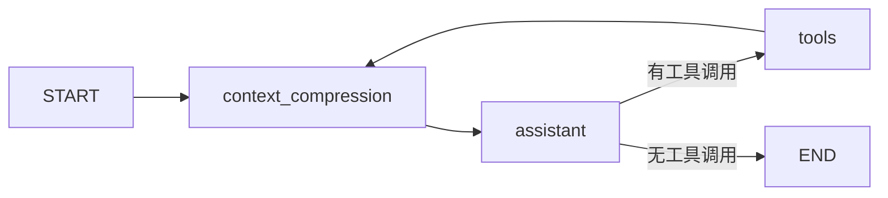

# 上下文压缩模块设计与实现

## 文档状态

- 状态：已实现
- 接口定义：`api/context_compression.yaml`
- 架构说明：`context/design.md` 的“上下文压缩模块”章节

## 1. 目标与边界

上下文压缩通过独立 Python 包 `k8s_ops_agent.context_compression` 提供，并作为 LangGraph `context_compression` 节点接入。模块根据模型 token 预算压缩较早的对话，给 assistant 节点生成本轮输入消息视图。

压缩器不修改原始 `messages`、不执行工具或审批、不新增业务数据库表。压缩结果通过 `context_messages` 图状态传给 assistant；assistant 调用模型后清空该状态字段。LangGraph 的节点快照可能保留节点输出，但原始消息历史不被替换，后续压缩重新从原始 `messages` 计算。

## 2. 模块结构

```text
src/k8s_ops_agent/context_compression/
  __init__.py    # 对外接口
  models.py      # 配置和结果数据结构
  compressor.py  # tokenizer、分组、预算与摘要
  node.py        # LangGraph 节点工厂
```

图节点由 `build_context_compression_node(prepare_prompt_messages)` 构建，模块通过注入的提示词构造器与主服务解耦。

## 3. 图执行流程



初始请求和每次工具调用结束后都会运行压缩节点。节点读取原始 `messages`，生成系统提示词和当前消息后估算 token 用量。若在预算内，则原样传递；超出预算时，将较早的完整消息组交给摘要模型，并将摘要消息与保留的近期消息组组成 `context_messages`。

## 4. 压缩规则

- 输入预算为上下文窗口减去输出预留量和安全余量；安全余量默认为窗口的 5%。
- 使用 `tiktoken` 按主模型编码估算 token；未知模型回退到 `cl100k_base`。
- 系统提示词、最新用户消息和最近消息组保留。
- assistant 工具调用与对应 ToolMessage 按调用 ID 成组；未完成的调用不进入摘要。
- 完整的历史纯文本消息组可以摘要；多模态消息或非文本消息保留原文。
- 摘要提示词要求仅记录输入明确给出的事实，保留故障对象、时间、来源、指标和单位，区分已确认、已排除及未知事项。
- 摘要以带版本标记的 SystemMessage 加入本轮上下文，并明确标记为不可信内容。
- 先保留配置数量的近期消息组；若仍超预算，可将更近期的完整消息组也纳入摘要。
- 如果摘要请求失败、受保护内容超出预算，或无法找到安全的历史摘要区，按失败关闭处理并阻止模型调用。

`CONTEXT_KEEP_RECENT_MESSAGES` 表示完整消息组的数量；包含工具调用和结果的消息组按一个整体计算。checkpoint 中的消息不会因压缩而删除或改写。

## 5. LangGraph 状态契约

输入：

- `messages: list[BaseMessage]`：LangGraph 原始消息历史。

输出：

- `context_messages: list[BaseMessage]`：本轮 assistant 输入视图。
- `compression_metadata: dict`：token 估算和压缩状态，不包含正文。

assistant 节点从 `context_messages` 调用模型，并在成功返回时清空该字段。模型调用异常会沿现有异常处理路径传播。

## 6. 配置

配置默认值定义在 `.env.example` 和 `api/context_compression.yaml`：

- `CONTEXT_COMPRESSION_ENABLED=true`
- `CONTEXT_WINDOW_TOKENS=128000`
- `CONTEXT_RESERVED_OUTPUT_TOKENS=2000`
- `CONTEXT_SAFETY_MARGIN_RATIO=0.05`
- `CONTEXT_KEEP_RECENT_MESSAGES=12`
- `CONTEXT_SUMMARY_MODEL=gpt-4o-mini`
- `CONTEXT_COMPRESSION_FAILURE_POLICY=fail_closed`

## 7. 日志与异常

压缩节点使用 JSON business 日志记录压缩状态、token 估算值、预算和消息组计数，不记录对话或摘要正文。摘要模型请求记录 `log_type=http`、method、path、duration_ms、status；异常记录 `log_type=exception` 和堆栈。超过预算时抛出 `ContextBudgetExceededError`，由 LangGraph 上游错误处理路径接收。

## 8. 依赖

模块使用现有 `langchain-core`、`langchain-openai` 和新增的直接依赖 `tiktoken`。摘要模型默认与 `OPENAI_MODEL` 相同，也可由 `CONTEXT_SUMMARY_MODEL` 单独指定。

