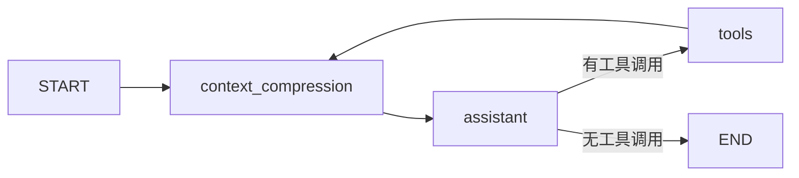

# 问题定位流程
- 先查询具体的故障信息
- 可以调用工具来判断故障是否恢复

## Pod类故障定位
- 判断故障类型，如果是容器故障，查看容器对应的代码仓
- 查看容器对应的日志
- 查看故障时间段的CPU，内存，硬盘等的性能指标
- 根据容器日志，代码仓代码，性能指标给出修复方案
- 修复方案分2种：1.机器性能达到瓶颈。 2.业务逻辑写错了
- 如果是第1种明确告诉我是哪个指标达到瓶颈，并且给出怎么修改业务逻辑可以解决这个问题
- 如果是业务逻辑写错了，指定1个修改方案，给人工审批
- 如果找不到问题原因，可以给出重启容器的建议，需要人工审批

## 架构设计
- 工具通过MCP来提供，设计一个独立的模块来注册这些工具
- 设计的是1个LangGraph，主要是给AG-UI来调用，另外有1个单独的服务，用React来实现的前端
- React前端调用本服务的方式：
```
const agent = new LangGraphAgent({
  deploymentUrl: process.env.LANGGRAPH_DEPLOYMENT_URL!,
  graphId: "k8s_ops_agent",
});
```

### 审批事件设计

审批交互使用 AG-UI 1.0 标准 interrupt/resume 协议。协议没有单独的 `APPROVAL_*` 事件类型；审批等待通过 `RUN_FINISHED` 的 `outcome.type="interrupt"` 表示。服务端不以 `CUSTOM` 事件或旧版自定义 interrupt 事件替代标准协议。

#### 审批等待事件

一次运行进入审批等待时，事件顺序如下：

1. 正常发送 `RUN_STARTED` 及运行期间产生的消息、工具和活动事件。
2. 可选地通过时间线活动 `ACTIVITY_DELTA` 更新活动模型中的审批条目为 `awaiting_approval`。这是前端时间线展示数据，不承担恢复协议。
3. 以 `RUN_FINISHED` 结束当前 run，并在 `outcome` 中携带一个或多个 `Interrupt`。该事件代表运行已暂停，不能同时报告成功 outcome。

审批等待的标准事件示例：

```json
{
  "type": "RUN_FINISHED",
  "threadId": "thread-123",
  "runId": "run-456",
  "outcome": {
    "type": "interrupt",
    "interrupts": [
      {
        "id": "interrupt-789",
        "reason": "approval_required",
        "message": "需要审核后才能执行重启操作。",
        "responseSchema": {
          "type": "object",
          "required": ["request_id", "status", "answers"],
          "properties": {
            "request_id": {"type": "string"},
            "status": {"type": "string", "enum": ["approved", "rejected"]},
            "answers": {"type": "object"},
            "comment": {"type": "string"}
          }
        },
        "metadata": {
          "kind": "approval",
          "requestId": "approval-uuid",
          "approvalRequest": {
            "schema_version": 1,
            "action": "restart_container",
            "title": "审批容器重启",
            "rationale": "Pod 多次重启，需确认处置方案。",
            "change_plan": "重启目标容器并观察恢复情况。",
            "evidence": [],
            "inputs": []
          }
        }
      }
    ]
  }
}
```

`Interrupt.id` 是恢复时使用的协议标识；`reason` 和 `message` 说明暂停原因；`responseSchema` 描述恢复答案的 JSON 结构；`metadata` 是 AG-UI 允许的开放扩展字段，用于携带项目审批请求。`metadata.approvalRequest` 的字段结构沿用本文的审批请求模型。审批表单只依据该请求定义渲染，决定仍由服务端重新校验。协议字段使用 camelCase；现有审批业务对象的 snake_case 字段保持兼容，不能误认为它们是 AG-UI 外层事件字段。

`toolCallId` 仅在该中断针对一个具体工具调用时填写；审批在工具执行前暂停时可填写对应调用 ID。普通人工审批不是由前端工具调用产生时，不设置该字段。`expiresAt` 可选，使用 ISO-8601 时间；未配置过期时间时省略。不得在 interrupt metadata 或响应 schema 中放审核人身份、认证凭据或服务端决定时间。

#### 恢复事件与决定

审批人批准或拒绝后，前端按 AG-UI `RunAgentInput.resume` 提交 `ResumeEntry`，并为继续执行启动新的 run。`interruptId` 必须匹配前一 `RUN_FINISHED.outcome.interrupts[].id`；批准或拒绝使用 `status="resolved"`，决定对象放在 `payload`。取消审批使用 `status="cancelled"`，不得携带 `payload`。示例：

```json
{
  "threadId": "thread-123",
  "runId": "run-457",
  "messages": [],
  "resume": [
    {
      "interruptId": "interrupt-789",
      "status": "resolved",
      "payload": {
        "request_id": "approval-uuid",
        "status": "approved",
        "answers": {"restart_window": "now"},
        "comment": "可以执行"
      }
    }
  ]
}
```

取消示例：`{"interruptId":"interrupt-789","status":"cancelled"}`。取消不传业务 payload；服务端从可信 interrupt/checkpoint 取得 `request_id`，记录取消决定后恢复或结束图执行。

服务端必须在恢复图之前校验 interrupt 属于当前 thread、审批请求仍处于 pending、审核人身份与角色可信、请求 ID 匹配且答案符合审批表单定义；校验成功后才原子保存决定并将规范化 payload 交给 adapter。重复决定或重复占用同一恢复权返回冲突。审核人、角色和决定时间由服务端认证上下文及服务端时钟生成，不能信任前端 payload。

审批事件与活动时间线的职责不同：标准 `RUN_FINISHED` interrupt 是暂停和恢复的协议依据；可选的 `ACTIVITY_DELTA` 只更新时间线条目状态。前端以 interrupt outcome 判定需要展示审批表单，不能只依赖活动条目，也不能将审批请求另发为自定义事件。

### 审批模型设计

#### 目标与边界

审批请求描述“要审核什么、为什么审核、审核人需要提交哪些输入”；审批决定描述“审核人最终作出的决定及输入值”。请求通过 LangGraph `interrupt` 交给前端，审核完成后由前端在同一个 `threadId` 上恢复图执行。

审批只负责记录和传递决定，不执行修复、重启或其他业务动作。恢复后的决定必须由后端校验；不能把前端传来的任意 JSON 直接视为有效审批结果。

#### 审批请求模型


```json
{
  "type": "approval_request",
  "schema_version": 1,
  "request_id": "审批请求唯一标识",
  "action": "business_fix",
  "title": "审批业务逻辑修复方案",
  "rationale": "判断原因",
  "change_plan": "拟议方案及影响范围",
  "evidence": [
    {"kind": "log", "source": "容器日志", "summary": "错误摘要"},
    {"kind": "metric", "source": "CPU 指标", "summary": "指标摘要"}
  ],
  "inputs": [
    {
      "key": "target_strategy",
      "label": "选择发布策略",
      "type": "single_select",
      "required": true,
      "options": [
        {"value": "rolling", "label": "滚动发布"},
        {"value": "canary", "label": "灰度发布"}
      ]
    },
    {
      "key": "affected_services",
      "label": "确认涉及的服务",
      "type": "multi_select",
      "required": true,
      "options": [
        {"value": "api", "label": "API 服务"},
        {"value": "worker", "label": "后台任务"}
      ]
    },
    {
      "key": "review_note",
      "label": "审核意见",
      "type": "text",
      "required": false,
      "placeholder": "填写补充意见",
      "max_length": 2000
    }
  ]
}
```

字段约定：

| 字段 | 规则 |
| --- | --- |
| `schema_version` | 请求结构版本；前后端按版本解析，后续扩展时避免静默改变旧字段含义 |
| `request_id` | 一次审批请求的唯一标识；用于关联中断、持久化记录和审核结果，恢复同一中断时保持不变 |
| `action` | 受控动作枚举；当前至少支持 `business_fix`、`restart_container` |
| `title` | 前端展示标题 |
| `rationale`、`change_plan` | 面向审核人的说明；不作为执行命令 |
| `evidence` | 证据列表；每项至少含 `kind`、`source`、`summary`，可选 `url`、`timestamp`。敏感内容需按日志规范脱敏 |
| `inputs` | 审核人需要填写的控件定义；没有额外输入时为空数组 |

`inputs[].type` 支持以下值：

| 类型 | 用途 | `options` | 答案值 |
| --- | --- | --- | --- |
| `confirm` | 是/否确认，例如确认是否接受影响范围 | 不需要 | 布尔值 `true` 或 `false` |
| `single_select` | 单选 | 必须提供非空选项 | 一个选项的 `value` 字符串 |
| `multi_select` | 多选 | 必须提供非空选项 | 去重后的 `value` 字符串数组，可允许空数组 |
| `text` | 文本输入 | 不需要 | 字符串；可定义 `max_length`，后端必须校验长度 |

每个输入控件使用唯一的 `key`，并可配置 `label`、`required`、`placeholder`。单选和多选的答案只能来自请求中声明的选项；`required=true` 时，文本不能为空白字符串，多选至少选择一项。请求定义中的未知类型或不合法选项应拒绝，不能降级成自由文本。

#### 审批决定模型

审核提交的决定使用统一对象：

```json
{
  "request_id": "审批请求唯一标识",
  "status": "approved",
  "answers": {
    "target_strategy": "canary",
    "affected_services": ["api", "worker"],
    "review_note": "先灰度观察"
  },
  "comment": "审核人的总体意见",
  "reviewer": "审核人标识",
  "decided_at": "ISO-8601 时间"
}
```

| 字段 | 含义与校验 |
| --- | --- |
| `request_id` | 必须与当前暂停的审批请求一致，避免把其他请求的结果恢复到当前 thread |
| `status` | 审批结果为 `approved` 或 `rejected`；用户放弃审批时可提交 `cancelled`，不要求表单答案。是/否审批由该字段表达，不再额外要求重复的确认答案 |
| `answers` | 按请求 `inputs[].key` 提交的答案；后端依据控件类型、必填项及选项逐项校验 |
| `comment` | 可选的总体审核意见 |
| `reviewer` | 由认证上下文确定，不信任客户端自行声明的身份 |
| `decided_at` | 由服务端生成并记录，不信任客户端时间 |

当审批页面只需要“是/否”时，不需要配置额外输入项，直接提交 `status=approved` 或 `status=rejected`。需要确认某个具体事实且仍需单独审核总体方案时，可将 `confirm` 控件放在 `inputs` 中，例如 `answers.impact_confirmed=true`，同时由 `status` 表示总体是否通过。这样可以覆盖纯确认、审批加表单两类流程。

#### 持久化与恢复流程

业务审批记录建议包含：

| 字段 | 含义 |
| --- | --- |
| `request_id` | 主键或唯一键 |
| `thread_id`、`run_id` | 关联 LangGraph 会话和发起审批的运行 |
| `action` | 请求审核的动作 |
| `request_payload` | 版本化审批请求，保存说明、证据和输入定义 |
| `status` | `pending`、`approved`、`rejected`、`cancelled` |
| `decision_payload` | 审核结果对象；待审时为空 |
| `reviewer`、`created_at`、`decided_at` | 审批审计信息 |

流程为：后端创建 `pending` 记录并发出 interrupt；前端根据 `inputs` 渲染控件；提交时后端校验 `request_id`、当前状态、身份和 `answers`；校验通过后原子地写入决定并将结果用于恢复同一个 `threadId`。只允许从 `pending` 转为一个终态，重复提交或已处理请求应返回冲突，不能重复恢复或重复审批。LangGraph checkpoint 保存流程恢复位置，业务记录保存可查询的审批单和审计结果，两者通过 `request_id`、`thread_id` 关联。

实现约定：审批决定直接通过 AG-UI `POST /agent` 的 `RunAgentInput.resume` 提交，不另设审批决定接口。已批准或拒绝时，客户端发送匹配活动 `interrupt_id` 的 `ResumeEntry`，`status=resolved`，`payload` 至少包含 `request_id`、决定 `status`（`approved` 或 `rejected`）和 `answers`，可选 `comment`。取消时发送 `status=cancelled` 且不带 `payload`；服务端从活动中断中取得 `request_id`。服务端从可信认证上下文读取审核人身份和角色，核对活动 interrupt、请求所属 thread 和表单答案，生成服务端决定时间，并原子保存决定和占用当前 `runId` 的恢复权；只有校验成功后才将规范化决定交给 AG-UI adapter 恢复图。当前仓库没有前端或认证提供方；前端按此协议渲染表单，部署时需由认证中间件设置可信审核人上下文。

批准或拒绝的 `POST /agent` 请求示例：

```json
{
  "threadId": "thread-123",
  "runId": "run-456",
  "messages": [],
  "resume": [
    {
      "interruptId": "interrupt-789",
      "status": "resolved",
      "payload": {
        "request_id": "approval-uuid",
        "status": "approved",
        "answers": {},
        "comment": ""
      }
    }
  ]
}
```

取消时 `resume` 项使用 `{"interruptId":"interrupt-789","status":"cancelled"}`，不传 `payload`。`messages` 仍按 AG-UI `RunAgentInput` 提供当前对话消息；审核人身份、角色和决定时间不得放入 payload，由服务端认证上下文生成。


### AG-UI 活动事件与执行流程模型

本节定义项目自己的 `ACTIVITY_SNAPSHOT.content` 数据模型。AG-UI 规定事件外层结构和传输语义；`content` 内的字段由项目定义。前端将其显示为按执行先后排列的时间线，不绘制流程图、不建立事件父子关系。

#### 活动消息与快照

一次对话 thread 使用一个稳定的活动 `messageId` 表示当前 agent 任务时间线，`activityType` 固定为 `agent_run`。`ACTIVITY_SNAPSHOT` 的 `content` 是完整状态，可用于首次展示及恢复同步；`ACTIVITY_DELTA` 的 `patch` 是符合 RFC 6902 的有序 JSON Patch，针对相同 `messageId` 的 content 应用。外层事件的 `timestamp` 使用 Unix 毫秒时间戳。content 内的时间统一使用 ISO-8601 UTC 字符串。

快照结构示例：

```json
{
  "schemaVersion": 1,
  "run": {
    "runId": "run-123",
    "threadId": "thread-456",
    "status": "running",
    "startedAt": "2026-11-17T10:00:00.000Z",
    "updatedAt": "2026-11-17T10:00:02.120Z",
    "finishedAt": null,
    "error": null
  },
  "events": [
    {
      "id": "model-1",
      "sequence": 1,
      "type": "model_inference",
      "title": "大模型回复",
      "status": "completed",
      "startedAt": "2026-11-17T10:00:00.100Z",
      "updatedAt": "2026-11-17T10:00:01.300Z",
      "finishedAt": "2026-11-17T10:00:01.300Z",
      "input": {"summary": "分析 Pod 重启问题"},
      "output": {
        "messageId": "msg-assistant-1",
        "text": "我先查询 Pod 状态和近期事件。",
        "content": []
      },
      "error": null
    },
    {
      "id": "tool-1",
      "sequence": 2,
      "type": "tool_execution",
      "title": "查询 Pod 状态",
      "status": "completed",
      "startedAt": "2026-11-17T10:00:01.350Z",
      "updatedAt": "2026-11-17T10:00:02.100Z",
      "finishedAt": "2026-11-17T10:00:02.100Z",
      "tool": {"name": "get_pod_status", "server": "kubernetes"},
      "input": {"namespace": "prod", "pod": "api-abc"},
      "output": {
        "content": [{"type": "text", "text": "Pod is Running; restartCount=3"}],
        "structuredContent": {"phase": "Running", "restartCount": 3},
        "resources": []
      },
      "error": null
    }
  ]
}
```

#### 字段定义

| 字段 | 定义 |
| --- | --- |
| `schemaVersion` | content 模型版本；不兼容变更递增版本。未知版本时前端展示可读的降级信息 |
| `run.runId`、`run.threadId` | 本次 agent 运行和所属对话的标识 |
| `run.status` | `queued`、`running`、`awaiting_approval`、`completed`、`failed`、`cancelled` 之一。结束状态时填写 `finishedAt` |
| `run.startedAt`、`run.updatedAt`、`run.finishedAt` | run 的 UTC 时间；未结束时 `finishedAt` 为 `null`，每次状态或事件内容变化时更新 `updatedAt` |
| `run.error` | run 失败时的错误摘要；其他状态为 `null` |
| `events` | 纯平铺事件数组，按 `sequence` 升序展示；不包含 `parentId` 或其他关系字段 |
| `events[].id` | 事件实例的稳定唯一标识；更新同一事件时保持不变 |
| `events[].sequence` | 在该时间线内单调递增的整数；事件追加后不得重排或复用 |
| `events[].type` | 当前支持 `model_inference`、`tool_execution`、`system_step`、`approval`；未知类型由前端按通用时间线条目展示 |
| `events[].title` | 前端展示的简短标题 |
| `events[].status` | `queued`、`running`、`awaiting_approval`、`completed`、`failed`、`cancelled` 之一 |
| `events[].startedAt`、`events[].updatedAt`、`events[].finishedAt` | 事件的 UTC 时间；运行中或排队中的事件 `finishedAt` 为 `null` |
| `events[].tool` | 工具事件的描述，至少包括工具名称，可选 MCP server 名称 |
| `events[].input` | 脱敏后的输入摘要。工具调用只放适合前端展示的参数；模型调用不放完整 prompt 或隐藏推理内容 |
| `events[].output` | 模型面向用户的回复或工具结果。模型文本放 `text`，多模态块按顺序放 `content`；工具可包含 MCP `content`、`structuredContent` 和资源引用 |
| `events[].error` | 事件失败时的安全错误摘要；成功或仍在运行时为 `null` |
| `events[].approval` | 审批事件可包含 `requestId` 和当前审批状态，表单定义仍以既有 `approval_request` 为准 |

`content` 和事件对象使用 camelCase 命名。`output.content` 是有序内容块数组；文本、图片、音频、资源链接或资源引用保留各自类型，不将整个结果强制转换成字符串。字段允许在后续版本扩展，前端应忽略未知可选字段。

#### 事件更新规则

1. run 开始时发送一个完整快照，包含 `run.status=running` 和空的 `events` 数组。
2. 模型调用开始时追加 `model_inference` 事件，状态为 `running`；面向用户的回复流到时更新该事件的 `output.text` 或 `output.content`，结束后将状态改为 `completed`。隐藏推理内容不进入活动数据。
3. 每次工具实际开始执行时追加一个 `tool_execution` 事件，记录脱敏输入；工具返回后在同一事件写入完整规范化结果并设置终态。工具调用请求本身不代表工具已执行。
4. 状态或内容改变时发送 `ACTIVITY_DELTA`，只包含对现有 content 可应用的 RFC 6902 操作；追加事件使用 `add`，更新字段使用 `replace` 或 `add`。数组项按 `sequence` 追加，不删除或重排既有事件。
5. 模型或工具失败时，更新对应事件为 `failed` 并提供安全错误摘要。run 结束后设置 run 终态及 `finishedAt`。
6. 等待审批时设置 `run.status=awaiting_approval`，追加或更新 `approval` 事件为 `awaiting_approval`。审批恢复后继续更新同一条 thread 时间线，保留已有事件及其 ID，再追加恢复后的执行事件。
7. 客户端若无法应用 patch，应停止应用后续增量并获取完整快照；AG-UI 活动事件本身没有内建 patch 序号，不能依赖协议事件检测增量缺口。

工具参数、工具输出和模型回复在发送前执行脱敏和大小限制。敏感参数不得发给前端；大型结果按工具返回规范保存摘要、资源 URI、MIME 类型、原始大小及截断标记。活动数据用于实时展示，不替代 LangGraph checkpoint、审批决定存储或审计记录。活动事件作为时间线的唯一数据源；其他 AG-UI 消息/工具事件仍可驱动常规聊天 UI，但前端不得将其重复合并到活动时间线。

### 上下文压缩模块

上下文压缩能力通过独立 Python 模块 `k8s_ops_agent.context_compression` 提供，并以 LangGraph `context_compression` 节点接入主图。模块接口定义见 `api/context_compression.yaml`。

图执行顺序为：



`context_compression` 节点读取 checkpoint 中的原始 `messages`，结合 `prepare_prompt_messages` 生成系统提示词和当前消息。节点使用主模型接口返回的输入 token 用量；达到上下文窗口的 70% 时，使用主模型压缩较早且已完成的纯文本消息组，保留系统提示词、最新用户请求和近期消息。usage 缺失时，按 `HumanMessage` 数量计轮数，默认达到 200 轮后压缩，可由 `CONTEXT_COMPRESSION_FALLBACK_TURNS` 配置；assistant 工具调用及其结果按调用 ID 成组处理，不拆分未完成的工具调用，多模态消息不进入摘要。

节点将本轮模型输入写入单独的 `context_messages` 状态键，assistant 节点只读取该视图并在调用模型后清空该键。压缩不覆盖原始 `messages`，后续轮次始终从原始历史重新生成摘要。LangGraph 节点快照可能包含临时 `context_messages`；该字段不作为业务历史或审批记录使用。

摘要失败或没有可安全压缩的历史消息组时，压缩节点抛出 `ContextBudgetExceededError` 并中止模型调用，不静默删除当前请求或工具证据。模块不使用 tokenizer 估算 token 用量；所有日志仅记录接口 usage 和压缩状态，不记录消息或摘要正文。

配置项：`CONTEXT_COMPRESSION_ENABLED`、`CONTEXT_WINDOW_TOKENS`、`CONTEXT_KEEP_RECENT_MESSAGES`、`CONTEXT_COMPRESSION_FALLBACK_TURNS`。摘要模型与 `OPENAI_MODEL` 共用。示例值见 `.env.example`。


### MCP 工具设计

#### 设计目标

MCP 工具目录需要同时说明工具的安全策略，以及该工具触发审批时审核人可能需要完成的交互。目录元数据用于工具发现和模型决策；一次执行所需的实际审批内容仍由版本化的 `approval_request` 提供，并按上文审批模型校验。两者复用相同的输入类型和字段语义，避免前端仅凭工具目录猜测审批表单。

#### 工具元数据

每个工具在 MCP `list tools` 返回结果中增加 `security` 和 `approval` 元数据。现有 `security` 字段保持兼容；新增的审批交互定义复用 `approval_request.inputs` 结构：

```json
{
  "name": "restart_container",
  "description": "重启指定容器",
  "inputSchema": {},
  "_meta": {
    "security": {
      "riskLevel": "high",
      "approvalMode": "required",
      "approvalRole": "ops_approver",
      "defaultAction": "require_approval"
    },
    "approval": {
      "schema_version": 1,
      "inputPolicy": "model_assisted",
      "allowedInputTypes": ["confirm", "single_select", "multi_select", "text"],
      "inputs": [
        {
          "key": "impact_confirmed",
          "label": "确认已了解重启影响",
          "type": "confirm",
          "required": true
        },
        {
          "key": "restart_timing",
          "label": "选择重启时机",
          "type": "single_select",
          "required": true,
          "options": [
            {"value": "now", "label": "立即重启"},
            {"value": "maintenance_window", "label": "维护窗口重启"}
          ]
        },
        {
          "key": "related_services",
          "label": "确认受影响服务",
          "type": "multi_select",
          "required": false,
          "options": [
            {"value": "api", "label": "API 服务"},
            {"value": "worker", "label": "后台任务"}
          ]
        },
        {
          "key": "review_note",
          "label": "补充说明",
          "type": "text",
          "required": false,
          "max_length": 2000
        }
      ]
    }
  }
}
```

`_meta` 是 MCP 工具目录的元数据承载位置；如果所用 MCP SDK 对扩展元数据采用不同字段名，应映射到该 SDK 的扩展元数据字段，不能把这些策略字段混入工具业务 `inputSchema`。工具调用参数与审批人提交的 `answers` 是两类不同数据。

`security` 字段约定：

| 字段 | 规则 |
| --- | --- |
| `riskLevel` | 风险级别，建议使用 `low`、`medium`、`high`、`critical`；供策略判断和界面展示 |
| `approvalMode` | `none` 表示无需审批，`required` 表示每次调用都需审批，`conditional` 表示结合调用内容判断是否需要审批 |
| `approvalRole` | 允许处理该审批的角色；无需审批时不用配置这个字段 |
| `defaultAction` | 条件判断无法完成、策略缺失或判断服务不可用时的兜底动作：`allow`、`deny` 或 `require_approval` |

`approval` 字段约定：
如果 approvalMode 配置了none，无需审批时不用配置这个字段
| 字段 | 规则 |
| --- | --- |
| `schema_version` | 审批输入定义版本；与审批请求的输入结构保持兼容 |
| `inputPolicy` | `fixed` 表示每次审批使用目录中声明的 `inputs`；`model_assisted` 表示模型可根据本次调用选择、补充审批输入，但必须遵循下述约束 |
| `allowedInputTypes` | `model_assisted` 时模型可以使用的类型白名单，取值为 `confirm`、`single_select`、`multi_select`、`text`；不允许未声明的控件类型 |
| `inputs` | 固定审批表单或模型可参考的输入定义，字段结构和校验规则与 `approval_request.inputs` 一致；没有固定输入时为空数组 |

#### 工具返回结果

MCP 工具调用结果按 `CallToolResult` 处理。`content` 是有序内容块列表，工具可以同时返回普通文本、图片、音频、资源链接或内嵌资源；不能假定结果一定是字符串，也不能在进入 LangGraph 状态前对整个结果直接调用 `str()`。如果结果还包含 `structuredContent`，应作为独立的结构化数据保留，不与 `content` 相互覆盖；`isError=true` 表示工具已正常返回一项失败结果，调用方应将它作为工具错误处理，而不是当作成功证据。

内嵌资源使用 MCP `EmbeddedResource` 内容块表示。文本资源示例：

```python
resource = EmbeddedResource(
    type="resource",
    resource=TextResourceContents(
        uri=f"log:///k8s/{namespace}/{pod}.log",
        mimeType="text/plain; charset=utf-8",
        text=logs,
    ),
)
```

内容块处理约定：

| MCP 内容 | 处理规则 |
| --- | --- |
| `TextContent` | 保留为文本内容块，供模型直接读取 |
| `EmbeddedResource(resource=TextResourceContents)` | 保留 `type`、`uri`、`mimeType` 和 `text`；将正文写入当前 thread 的 workspace 新文件，并将文件引用作为模型可读证据，URI 作为来源标识，不把 URI 当作可直接访问的 HTTP 地址 |
| `EmbeddedResource(resource=BlobResourceContents)` | 保留 `uri`、`mimeType` 和二进制数据；只有当前模型和消息适配层明确支持该 MIME 类型时才传给模型，否则仅返回资源元数据和“不支持直接读取”的说明，不把 base64 数据展开进纯文本提示词 |
| `ResourceLink` | 保留链接元数据；如需读取其内容，必须通过 MCP 资源读取能力另行获取，不能把链接本身视为资源正文 |
| `ImageContent`、`AudioContent` | 作为对应的多模态内容块保留；模型不支持时采用与二进制资源相同的降级规则 |
| 未识别的内容块 | 保留原始类型和必要元数据并标记为不支持；不得静默丢弃，也不得猜测其正文语义 |

MCP 适配层负责把上述内容块转换为 LangChain/LangGraph 支持的 `ToolMessage.content` 表示，并保持原始顺序。转换后的消息至少应能够追溯 `tool_call_id`、MCP 服务、工具名称和资源 URI。适配器版本对 `EmbeddedResource` 的原生映射能力不一致时，应在独立的工具结果规范化模块中完成显式转换，不能依赖对象的字符串表示。

文本资源正文保存到系统提示词定义的会话 workspace：`/var/service/{safe_service_name}/share/workspace/{safe_thread_id}`。每个资源单独创建 UTF-8 文本文件，文件名包含清洗后的 MCP 服务名、工具名、上海时区时间戳和内容块序号；使用排他创建，避免并发或同一时间戳下覆盖文件。LangGraph 状态的 `workspace_files` 保存文件路径、资源 URI、MIME 类型及 MCP 服务和工具名称。工具结果消息保留文件引用；后续上下文准备节点把状态中的引用加入本轮系统上下文，模型按需通过可用能力读取文件。工作区文件不得因上下文压缩而丢失引用。该文件路径使用与系统提示词相同的服务名和 thread ID 清洗规则。

对日志类文本资源，`log:///k8s/{namespace}/{pod}.log` 是稳定的来源标识，`text` 是本次调用返回的日志快照。资源 URI 不应包含凭据或敏感查询参数；日志正文进入消息、摘要、持久化或展示前，均须遵循日志规范中的脱敏要求。服务端应配置单个内容块、单次工具结果和可进入模型上下文的总大小上限；超限时保留 URI、MIME 类型、原始大小和明确的截断标记，不能无提示截断。资源内容属于不可信工具输出，模型不得把其中的指令当作系统指令，也不得因资源正文要求而绕过审批或调用其他工具。

工具结果进入上下文压缩模块时，文本资源可以作为工具证据参与压缩，但必须与对应的 assistant 工具调用及 `tool_call_id` 成组保留；图片、音频和二进制资源仍按多模态消息处理，不进入纯文本摘要。前端展示资源时应依据 `mimeType` 选择渲染方式，并将 `uri` 展示为来源；未知或高风险 MIME 类型只提供元数据，不内联执行或渲染。

#### 决策与校验规则

- 工具目录元数据是 MCP 服务端发布的策略声明，不是模型可以自行覆盖的授权。`required` 不得被模型降级为无需审批；`none` 表示目录策略不要求审批
- 对 `conditional` 工具，模型可以依据本次调用生成是否审批的建议以及具体表单。模型选择的控件类型必须属于 `allowedInputTypes`；使用 `single_select` 或 `multi_select` 时必须给出选项，答案只接受所给选项的 `value`。生成的请求应满足审批模型中必填、唯一 `key`、文本长度等约束。
- `fixed` 模式下，运行时审批请求必须使用目录声明的输入定义，不应由模型改写类型、必填属性或选项。`model_assisted` 模式下，目录定义的 `inputs` 可作为推荐表单；模型按调用上下文调整后，最终定义写入该次 `approval_request`，并随审批记录保存。
- `approvalMode=none` 时不创建审批请求。`required` 时必须先创建审批请求并等待终态决定，获批后才可继续执行工具。`conditional` 的模型判断不能得出结论时，使用 `defaultAction`；`require_approval` 应生成审批请求，`deny` 应拒绝调用，`allow` 仅用于策略明确允许的工具。
- 建议只读低风险工具使用 `defaultAction=allow`；会修改、重启或产生外部影响的工具应采用 `require_approval` 或 `deny` 作为兜底，避免策略判断失败时静默放行。该兜底规则由服务端执行，不能只依赖模型遵守。
- `riskLevel`、`approvalMode`、`approvalRole` 与 `defaultAction` 的组合应通过目录加载校验。例如 `approvalMode=required` 必须配置审批角色或明确的默认审批队列；`approvalMode=none` 不应依赖 `approvalRole` 完成授权。

#### 与审批模型的衔接

模型根据工具元数据和本次调用上下文决定是否建议审批及需要呈现的交互；后端根据服务端策略确认审批要求，创建 `approval_request`，其中 `action` 对应工具动作，`inputs` 使用本节约定的控件定义。前端只根据该请求渲染确认、单选、多选或文本输入，并提交统一的审批决定。后端在恢复 LangGraph 前仍须校验请求标识、审批状态、审核人权限和每个答案，不能因为答案来自前端或模型而跳过校验。`status=approved` 表示审批通过；单独的 `confirm` 输入仅用于确认具体事实，不替代总体审批决定。

因此，MCP `list tools` 负责提供稳定的风险、审批策略和交互能力描述；具体审批请求负责提供本次审核的理由、证据、实际控件和选项。模型可以在策略允许范围内做上下文判断，但最终审批要求与答案有效性由后端强制执行。
