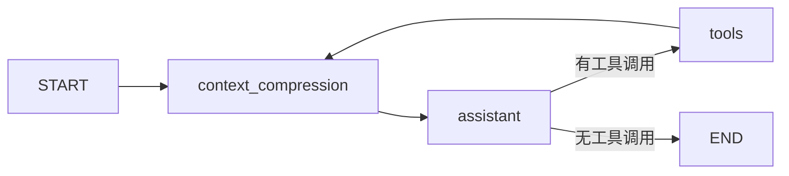

# 问题定位流程
- 先查询具体的故障信息
- 可以调用工具来判断故障是否恢复

## Pod类故障定位
- 判断故障类型，如果是容器故障，查看容器对应的代码仓
- 查看容器对应的日志
- 查看故障时间段的CPU，内存，硬盘等的性能指标
- 根据容器日志，代码仓代码，性能指标给出修复方案
- 修复方案分2种：1.机器性能达到瓶颈。 2.业务逻辑写错了
- 如果是第1种明确告诉我是哪个指标达到瓶颈，并且给出怎么修改业务逻辑可以解决这个问题
- 如果是业务逻辑写错了，指定1个修改方案，给人工审批
- 如果找不到问题原因，可以给出重启容器的建议，需要人工审批

## 架构设计
- 工具通过MCP来提供，设计一个独立的模块来注册这些工具
- 设计的是1个LangGraph，主要是给AG-UI来调用，另外有1个单独的服务，用React来实现的前端
- React前端调用本服务的方式：
```
const agent = new LangGraphAgent({
  deploymentUrl: process.env.LANGGRAPH_DEPLOYMENT_URL!,
  graphId: "k8s_ops_agent",
});
```

### 上下文压缩模块

上下文压缩能力通过独立 Python 模块 `k8s_ops_agent.context_compression` 提供，并以 LangGraph `context_compression` 节点接入主图。模块接口定义见 `api/context_compression.yaml`。

图执行顺序为：



`context_compression` 节点读取 checkpoint 中的原始 `messages`，结合 `prepare_prompt_messages` 生成系统提示词和当前消息，再按模型上下文窗口、输出预留量及安全余量估算输入预算。预算不足时，节点使用独立摘要模型压缩较早且已完成的纯文本消息组，保留系统提示词、最新用户请求和近期消息；assistant 工具调用及其结果按调用 ID 成组处理，不拆分未完成的工具调用，多模态消息不进入摘要。

节点将本轮模型输入写入单独的 `context_messages` 状态键，assistant 节点只读取该视图并在调用模型后清空该键。压缩不覆盖原始 `messages`，后续轮次始终从原始历史重新生成摘要。LangGraph 节点快照可能包含临时 `context_messages`；该字段不作为业务历史或审批记录使用。

如果受保护消息仍超出输入预算，压缩节点抛出 `ContextBudgetExceededError` 并中止模型调用，不静默删除当前请求或工具证据。摘要失败同样按失败关闭处理。模块使用 `tiktoken` 估算输入用量，所有日志仅记录 token 数和压缩状态，不记录消息或摘要正文。

配置项：`CONTEXT_COMPRESSION_ENABLED`、`CONTEXT_WINDOW_TOKENS`、`CONTEXT_RESERVED_OUTPUT_TOKENS`、`CONTEXT_SAFETY_MARGIN_RATIO`、`CONTEXT_KEEP_RECENT_MESSAGES`、`CONTEXT_SUMMARY_MODEL`。示例值见 `.env.example`。

### 审批模型设计

#### 目标与边界

审批请求描述“要审核什么、为什么审核、审核人需要提交哪些输入”；审批决定描述“审核人最终作出的决定及输入值”。请求通过 LangGraph `interrupt` 交给前端，审核完成后由前端在同一个 `threadId` 上恢复图执行。

审批只负责记录和传递决定，不执行修复、重启或其他业务动作。恢复后的决定必须由后端校验；不能把前端传来的任意 JSON 直接视为有效审批结果。

#### 审批请求模型


```json
{
  "type": "approval_request",
  "schema_version": 1,
  "request_id": "审批请求唯一标识",
  "action": "business_fix",
  "title": "审批业务逻辑修复方案",
  "rationale": "判断原因",
  "change_plan": "拟议方案及影响范围",
  "evidence": [
    {"kind": "log", "source": "容器日志", "summary": "错误摘要"},
    {"kind": "metric", "source": "CPU 指标", "summary": "指标摘要"}
  ],
  "inputs": [
    {
      "key": "target_strategy",
      "label": "选择发布策略",
      "type": "single_select",
      "required": true,
      "options": [
        {"value": "rolling", "label": "滚动发布"},
        {"value": "canary", "label": "灰度发布"}
      ]
    },
    {
      "key": "affected_services",
      "label": "确认涉及的服务",
      "type": "multi_select",
      "required": true,
      "options": [
        {"value": "api", "label": "API 服务"},
        {"value": "worker", "label": "后台任务"}
      ]
    },
    {
      "key": "review_note",
      "label": "审核意见",
      "type": "text",
      "required": false,
      "placeholder": "填写补充意见",
      "max_length": 2000
    }
  ]
}
```

字段约定：

| 字段 | 规则 |
| --- | --- |
| `schema_version` | 请求结构版本；前后端按版本解析，后续扩展时避免静默改变旧字段含义 |
| `request_id` | 一次审批请求的唯一标识；用于关联中断、持久化记录和审核结果，恢复同一中断时保持不变 |
| `action` | 受控动作枚举；当前至少支持 `business_fix`、`restart_container` |
| `title` | 前端展示标题 |
| `rationale`、`change_plan` | 面向审核人的说明；不作为执行命令 |
| `evidence` | 证据列表；每项至少含 `kind`、`source`、`summary`，可选 `url`、`timestamp`。敏感内容需按日志规范脱敏 |
| `inputs` | 审核人需要填写的控件定义；没有额外输入时为空数组 |

`inputs[].type` 支持以下值：

| 类型 | 用途 | `options` | 答案值 |
| --- | --- | --- | --- |
| `confirm` | 是/否确认，例如确认是否接受影响范围 | 不需要 | 布尔值 `true` 或 `false` |
| `single_select` | 单选 | 必须提供非空选项 | 一个选项的 `value` 字符串 |
| `multi_select` | 多选 | 必须提供非空选项 | 去重后的 `value` 字符串数组，可允许空数组 |
| `text` | 文本输入 | 不需要 | 字符串；可定义 `max_length`，后端必须校验长度 |

每个输入控件使用唯一的 `key`，并可配置 `label`、`required`、`placeholder`。单选和多选的答案只能来自请求中声明的选项；`required=true` 时，文本不能为空白字符串，多选至少选择一项。请求定义中的未知类型或不合法选项应拒绝，不能降级成自由文本。

#### 审批决定模型

审核提交的决定使用统一对象：

```json
{
  "request_id": "审批请求唯一标识",
  "status": "approved",
  "answers": {
    "target_strategy": "canary",
    "affected_services": ["api", "worker"],
    "review_note": "先灰度观察"
  },
  "comment": "审核人的总体意见",
  "reviewer": "审核人标识",
  "decided_at": "ISO-8601 时间"
}
```

| 字段 | 含义与校验 |
| --- | --- |
| `request_id` | 必须与当前暂停的审批请求一致，避免把其他请求的结果恢复到当前 thread |
| `status` | 审批结果为 `approved` 或 `rejected`；用户放弃审批时可提交 `cancelled`，不要求表单答案。是/否审批由该字段表达，不再额外要求重复的确认答案 |
| `answers` | 按请求 `inputs[].key` 提交的答案；后端依据控件类型、必填项及选项逐项校验 |
| `comment` | 可选的总体审核意见 |
| `reviewer` | 由认证上下文确定，不信任客户端自行声明的身份 |
| `decided_at` | 由服务端生成并记录，不信任客户端时间 |

当审批页面只需要“是/否”时，不需要配置额外输入项，直接提交 `status=approved` 或 `status=rejected`。需要确认某个具体事实且仍需单独审核总体方案时，可将 `confirm` 控件放在 `inputs` 中，例如 `answers.impact_confirmed=true`，同时由 `status` 表示总体是否通过。这样可以覆盖纯确认、审批加表单两类流程。

#### 持久化与恢复流程

业务审批记录建议包含：

| 字段 | 含义 |
| --- | --- |
| `request_id` | 主键或唯一键 |
| `thread_id`、`run_id` | 关联 LangGraph 会话和发起审批的运行 |
| `action` | 请求审核的动作 |
| `request_payload` | 版本化审批请求，保存说明、证据和输入定义 |
| `status` | `pending`、`approved`、`rejected`、`cancelled` |
| `decision_payload` | 审核结果对象；待审时为空 |
| `reviewer`、`created_at`、`decided_at` | 审批审计信息 |

流程为：后端创建 `pending` 记录并发出 interrupt；前端根据 `inputs` 渲染控件；提交时后端校验 `request_id`、当前状态、身份和 `answers`；校验通过后原子地写入决定并将结果用于恢复同一个 `threadId`。只允许从 `pending` 转为一个终态，重复提交或已处理请求应返回冲突，不能重复恢复或重复审批。LangGraph checkpoint 保存流程恢复位置，业务记录保存可查询的审批单和审计结果，两者通过 `request_id`、`thread_id` 关联。

实现约定：审批决定直接通过 AG-UI `POST /agent` 的 `RunAgentInput.resume` 提交，不另设审批决定接口。已批准或拒绝时，客户端发送匹配活动 `interrupt_id` 的 `ResumeEntry`，`status=resolved`，`payload` 至少包含 `request_id`、决定 `status`（`approved` 或 `rejected`）和 `answers`，可选 `comment`。取消时发送 `status=cancelled` 且不带 `payload`；服务端从活动中断中取得 `request_id`。服务端从可信认证上下文读取审核人身份和角色，核对活动 interrupt、请求所属 thread 和表单答案，生成服务端决定时间，并原子保存决定和占用当前 `runId` 的恢复权；只有校验成功后才将规范化决定交给 AG-UI adapter 恢复图。当前仓库没有前端或认证提供方；前端按此协议渲染表单，部署时需由认证中间件设置可信审核人上下文。

批准或拒绝的 `POST /agent` 请求示例：

```json
{
  "threadId": "thread-123",
  "runId": "run-456",
  "messages": [],
  "resume": [
    {
      "interruptId": "interrupt-789",
      "status": "resolved",
      "payload": {
        "request_id": "approval-uuid",
        "status": "approved",
        "answers": {},
        "comment": ""
      }
    }
  ]
}
```

取消时 `resume` 项使用 `{"interruptId":"interrupt-789","status":"cancelled"}`，不传 `payload`。`messages` 仍按 AG-UI `RunAgentInput` 提供当前对话消息；审核人身份、角色和决定时间不得放入 payload，由服务端认证上下文生成。

### MCP 工具设计

#### 设计目标

MCP 工具目录需要同时说明工具的安全策略，以及该工具触发审批时审核人可能需要完成的交互。目录元数据用于工具发现和模型决策；一次执行所需的实际审批内容仍由版本化的 `approval_request` 提供，并按上文审批模型校验。两者复用相同的输入类型和字段语义，避免前端仅凭工具目录猜测审批表单。

#### 工具元数据

每个工具在 MCP `list tools` 返回结果中增加 `security` 和 `approval` 元数据。现有 `security` 字段保持兼容；新增的审批交互定义复用 `approval_request.inputs` 结构：

```json
{
  "name": "restart_container",
  "description": "重启指定容器",
  "inputSchema": {},
  "_meta": {
    "security": {
      "riskLevel": "high",
      "approvalMode": "required",
      "approvalRole": "ops_approver",
      "defaultAction": "require_approval"
    },
    "approval": {
      "schema_version": 1,
      "inputPolicy": "model_assisted",
      "allowedInputTypes": ["confirm", "single_select", "multi_select", "text"],
      "inputs": [
        {
          "key": "impact_confirmed",
          "label": "确认已了解重启影响",
          "type": "confirm",
          "required": true
        },
        {
          "key": "restart_timing",
          "label": "选择重启时机",
          "type": "single_select",
          "required": true,
          "options": [
            {"value": "now", "label": "立即重启"},
            {"value": "maintenance_window", "label": "维护窗口重启"}
          ]
        },
        {
          "key": "related_services",
          "label": "确认受影响服务",
          "type": "multi_select",
          "required": false,
          "options": [
            {"value": "api", "label": "API 服务"},
            {"value": "worker", "label": "后台任务"}
          ]
        },
        {
          "key": "review_note",
          "label": "补充说明",
          "type": "text",
          "required": false,
          "max_length": 2000
        }
      ]
    }
  }
}
```

`_meta` 是 MCP 工具目录的元数据承载位置；如果所用 MCP SDK 对扩展元数据采用不同字段名，应映射到该 SDK 的扩展元数据字段，不能把这些策略字段混入工具业务 `inputSchema`。工具调用参数与审批人提交的 `answers` 是两类不同数据。

`security` 字段约定：

| 字段 | 规则 |
| --- | --- |
| `riskLevel` | 风险级别，建议使用 `low`、`medium`、`high`、`critical`；供策略判断和界面展示 |
| `approvalMode` | `none` 表示无需审批，`required` 表示每次调用都需审批，`conditional` 表示结合调用内容判断是否需要审批 |
| `approvalRole` | 允许处理该审批的角色；无需审批时可为空 |
| `defaultAction` | 条件判断无法完成、策略缺失或判断服务不可用时的兜底动作：`allow`、`deny` 或 `require_approval` |

`approval` 字段约定：

| 字段 | 规则 |
| --- | --- |
| `schema_version` | 审批输入定义版本；与审批请求的输入结构保持兼容 |
| `inputPolicy` | `fixed` 表示每次审批使用目录中声明的 `inputs`；`model_assisted` 表示模型可根据本次调用选择、补充审批输入，但必须遵循下述约束 |
| `allowedInputTypes` | `model_assisted` 时模型可以使用的类型白名单，取值为 `confirm`、`single_select`、`multi_select`、`text`；不允许未声明的控件类型 |
| `inputs` | 固定审批表单或模型可参考的输入定义，字段结构和校验规则与 `approval_request.inputs` 一致；没有固定输入时为空数组 |

#### 决策与校验规则

- 工具目录元数据是 MCP 服务端发布的策略声明，不是模型可以自行覆盖的授权。`required` 不得被模型降级为无需审批；`none` 表示目录策略不要求审批，模型可基于风险升级为审批，但不能借此放宽工具服务端自身的鉴权和执行策略。
- 对 `conditional` 工具，模型可以依据本次调用生成是否审批的建议以及具体表单。模型选择的控件类型必须属于 `allowedInputTypes`；使用 `single_select` 或 `multi_select` 时必须给出选项，答案只接受所给选项的 `value`。生成的请求应满足审批模型中必填、唯一 `key`、文本长度等约束。
- `fixed` 模式下，运行时审批请求必须使用目录声明的输入定义，不应由模型改写类型、必填属性或选项。`model_assisted` 模式下，目录定义的 `inputs` 可作为推荐表单；模型按调用上下文调整后，最终定义写入该次 `approval_request`，并随审批记录保存。
- `approvalMode=none` 时可不创建审批请求。`required` 时必须先创建审批请求并等待终态决定，获批后才可继续执行工具。`conditional` 的模型判断不能得出结论时，使用 `defaultAction`；`require_approval` 应生成审批请求，`deny` 应拒绝调用，`allow` 仅用于策略明确允许的工具。
- 建议只读低风险工具使用 `defaultAction=allow`；会修改、重启或产生外部影响的工具应采用 `require_approval` 或 `deny` 作为兜底，避免策略判断失败时静默放行。该兜底规则由服务端执行，不能只依赖模型遵守。
- `riskLevel`、`approvalMode`、`approvalRole` 与 `defaultAction` 的组合应通过目录加载校验。例如 `approvalMode=required` 必须配置审批角色或明确的默认审批队列；`approvalMode=none` 不应依赖 `approvalRole` 完成授权。

#### 与审批模型的衔接

模型根据工具元数据和本次调用上下文决定是否建议审批及需要呈现的交互；后端根据服务端策略确认审批要求，创建 `approval_request`，其中 `action` 对应工具动作，`inputs` 使用本节约定的控件定义。前端只根据该请求渲染确认、单选、多选或文本输入，并提交统一的审批决定。后端在恢复 LangGraph 前仍须校验请求标识、审批状态、审核人权限和每个答案，不能因为答案来自前端或模型而跳过校验。`status=approved` 表示审批通过；单独的 `confirm` 输入仅用于确认具体事实，不替代总体审批决定。

因此，MCP `list tools` 负责提供稳定的风险、审批策略和交互能力描述；具体审批请求负责提供本次审核的理由、证据、实际控件和选项。模型可以在策略允许范围内做上下文判断，但最终审批要求与答案有效性由后端强制执行。
