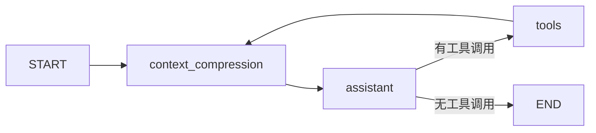

### AG-UI 活动事件与执行流程模型

本节定义项目自己的 `ACTIVITY_SNAPSHOT.content` 数据模型。AG-UI 规定事件外层结构和传输语义；`content` 内的字段由项目定义。前端将其显示为按执行先后排列的时间线，不绘制流程图、不建立事件父子关系。

#### 活动消息与快照

一次对话 thread 使用一个稳定的活动 `messageId` 表示当前 agent 任务时间线，`activityType` 固定为 `agent_run`。`ACTIVITY_SNAPSHOT` 的 `content` 是完整状态，可用于首次展示及恢复同步；`ACTIVITY_DELTA` 的 `patch` 是符合 RFC 6902 的有序 JSON Patch，针对相同 `messageId` 的 content 应用。外层事件的 `timestamp` 使用 Unix 毫秒时间戳。content 内的时间统一使用 ISO-8601 UTC 字符串。

快照结构示例：

```json
{
  "schemaVersion": 1,
  "run": {
    "runId": "run-123",
    "threadId": "thread-456",
    "status": "running",
    "startedAt": "2026-11-17T10:00:00.000Z",
    "updatedAt": "2026-11-17T10:00:02.120Z",
    "finishedAt": null,
    "error": null
  },
  "events": [
    {
      "id": "model-1",
      "sequence": 1,
      "type": "model_inference",
      "title": "大模型回复",
      "status": "completed",
      "startedAt": "2026-11-17T10:00:00.100Z",
      "updatedAt": "2026-11-17T10:00:01.300Z",
      "finishedAt": "2026-11-17T10:00:01.300Z",
      "input": {"summary": "分析 Pod 重启问题"},
      "correlation": {"messageId": "msg-assistant-1"},
      "output": {
        "messageId": "msg-assistant-1",
        "text": "我先查询 Pod 状态和近期事件。",
        "content": []
      },
      "error": null
    },
    {
      "id": "tool-1",
      "sequence": 2,
      "type": "tool_execution",
      "title": "查询 Pod 状态",
      "status": "completed",
      "startedAt": "2026-11-17T10:00:01.350Z",
      "updatedAt": "2026-11-17T10:00:02.100Z",
      "finishedAt": "2026-11-17T10:00:02.100Z",
      "tool": {"name": "get_pod_status", "server": "kubernetes"},
      "correlation": {"toolCallId": "call-789"},
      "input": {"namespace": "prod", "pod": "api-abc"},
      "output": {
        "content": [{"type": "text", "text": "Pod is Running; restartCount=3"}],
        "structuredContent": {"phase": "Running", "restartCount": 3},
        "resources": []
      },
      "error": null
    }
  ]
}
```

#### 字段定义

| 字段 | 定义 |
| --- | --- |
| `schemaVersion` | content 模型版本；不兼容变更递增版本。未知版本时前端展示可读的降级信息 |
| `run.runId`、`run.threadId` | 本次 agent 运行和所属对话的标识 |
| `run.status` | `queued`、`running`、`awaiting_approval`、`completed`、`failed`、`cancelled` 之一。结束状态时填写 `finishedAt` |
| `run.startedAt`、`run.updatedAt`、`run.finishedAt` | run 的 UTC 时间；未结束时 `finishedAt` 为 `null`，每次状态或事件内容变化时更新 `updatedAt` |
| `run.error` | run 失败时的错误摘要；其他状态为 `null` |
| `events` | 纯平铺事件数组，按 `sequence` 升序展示；不包含 `parentId` 或其他关系字段 |
| `events[].id` | 事件实例的稳定唯一标识；更新同一事件时保持不变 |
| `events[].sequence` | 在该时间线内单调递增的整数；事件追加后不得重排或复用 |
| `events[].type` | 当前支持 `model_inference`、`tool_execution`、`system_step`、`approval`；未知类型由前端按通用时间线条目展示 |
| `events[].title` | 前端展示的简短标题 |
| `events[].status` | `queued`、`running`、`awaiting_approval`、`completed`、`failed`、`cancelled` 之一 |
| `events[].startedAt`、`events[].updatedAt`、`events[].finishedAt` | 事件的 UTC 时间；运行中或排队中的事件 `finishedAt` 为 `null` |
| `events[].tool` | 工具事件的描述，至少包括工具名称，可选 MCP server 名称 |
| `events[].correlation` | 与 AG-UI 原始事件流的关联键。`tool_execution` 必须包含 `toolCallId`，对应 `TOOL_CALL_START` 和 `TOOL_CALL_RESULT` 的 `tool_call_id`；`model_inference` 必须包含 `messageId`，对应 `TEXT_MESSAGE_START`、`TEXT_MESSAGE_CONTENT`、`TEXT_MESSAGE_END` 的 `message_id` |
| `events[].input` | 脱敏后的输入摘要。工具调用只放适合前端展示的参数；模型调用不放完整 prompt 或隐藏推理内容 |
| `events[].output` | 模型面向用户的回复或工具结果。模型文本放 `text`，多模态块按顺序放 `content`；工具可包含 MCP `content`、`structuredContent` 和资源引用 |
| `events[].error` | 事件失败时的安全错误摘要；成功或仍在运行时为 `null` |
| `events[].approval` | 审批事件可包含 `requestId` 和当前审批状态，表单定义仍以既有 `approval_request` 为准 |

`content` 和事件对象使用 camelCase 命名。`output.content` 是有序内容块数组；文本、图片、音频、资源链接或资源引用保留各自类型，不将整个结果强制转换成字符串。字段允许在后续版本扩展，前端应忽略未知可选字段。

#### 事件关联

活动事件通过 `correlation` 中的协议标识与 AG-UI 事件流关联，不建立活动条目之间的父子关系：

- `tool_execution.correlation.toolCallId` 保存工具调用 ID。它必须与对应的 `TOOL_CALL_START.tool_call_id` 和 `TOOL_CALL_RESULT.tool_call_id` 相同。收到 `TOOL_CALL_START` 时创建活动条目；收到匹配的 `TOOL_CALL_RESULT` 时更新该条目的 `output`、状态和结束时间。工具结果先于活动条目创建或缺少匹配 ID 时，不能错误地关联到其他工具调用。
- `model_inference.correlation.messageId` 保存助手消息 ID，对应 `TEXT_MESSAGE_START.message_id`、`TEXT_MESSAGE_CONTENT.message_id` 和 `TEXT_MESSAGE_END.message_id`。一条模型活动可关联一条或多条助手消息时，每条消息必须有独立的 `messageId` 关联记录；当前 schema 描述单条消息关联。消息文本 delta 由客户端按 `messageId` 分组并按事件到达顺序拼接，直到对应的 `TEXT_MESSAGE_END`。客户端不得把不同 `messageId` 的 delta 合并。若活动 `output.text` 已由服务端提供完整文本，应以该字段作为快照内容；否则使用关联的文本事件重建。`output.messageId` 与 `correlation.messageId` 应一致，便于恢复快照后继续识别消息。
- 文本消息事件可能在活动条目创建之前到达。客户端应暂存尚无关联条目的 delta，并在看到带相同 `messageId` 的活动条目后归并；收到活动快照时，则以快照关联键恢复分组。活动时间线仍只展示 `ACTIVITY_*` 数据，普通 AG-UI 消息事件用于消息 UI 和文本重建，不另行生成时间线条目。

`context/activity.schema.yaml` 定义 `ACTIVITY_SNAPSHOT.content` 的 JSON Schema（YAML 编写）。它约束快照及活动条目结构；关联键是连接两类事件流的唯一约定，AG-UI 外层事件字段仍由 AG-UI 协议定义。

#### 事件更新规则

1. run 开始时发送一个完整快照，包含 `run.status=running` 和空的 `events` 数组。
2. 模型调用开始时追加 `model_inference` 事件，状态为 `running`；面向用户的回复流到时更新该事件的 `output.text` 或 `output.content`，结束后将状态改为 `completed`。隐藏推理内容不进入活动数据。
3. 每次工具实际开始执行时追加一个 `tool_execution` 事件，记录脱敏输入；工具返回后在同一事件写入完整规范化结果并设置终态。工具调用请求本身不代表工具已执行。
4. 状态或内容改变时发送 `ACTIVITY_DELTA`，只包含对现有 content 可应用的 RFC 6902 操作；追加事件使用 `add`，更新字段使用 `replace` 或 `add`。数组项按 `sequence` 追加，不删除或重排既有事件。
5. 模型或工具失败时，更新对应事件为 `failed` 并提供安全错误摘要。run 结束后设置 run 终态及 `finishedAt`。
6. 等待审批时设置 `run.status=awaiting_approval`，追加或更新 `approval` 事件为 `awaiting_approval`。审批恢复后继续更新同一条 thread 时间线，保留已有事件及其 ID，再追加恢复后的执行事件。
7. 客户端若无法应用 patch，应停止应用后续增量并获取完整快照；AG-UI 活动事件本身没有内建 patch 序号，不能依赖协议事件检测增量缺口。

工具参数、工具输出和模型回复在发送前执行脱敏和大小限制。敏感参数不得发给前端；大型结果按工具返回规范保存摘要、资源 URI、MIME 类型、原始大小及截断标记。活动数据用于实时展示，不替代 LangGraph checkpoint、审批决定存储或审计记录。活动事件作为时间线的唯一数据源；其他 AG-UI 消息/工具事件仍可驱动常规聊天 UI，但前端不得将其重复合并到活动时间线。

### 上下文压缩模块

上下文压缩能力通过独立 Python 模块 `k8s_ops_agent.context_compression` 提供，并以 LangGraph `context_compression` 节点接入主图。模块接口定义见 `api/context_compression.yaml`。

图执行顺序为：



`context_compression` 节点读取 checkpoint 中的原始 `messages`，结合 `prepare_prompt_messages` 生成系统提示词和当前消息。节点使用主模型接口返回的输入 token 用量；达到上下文窗口的 70% 时，使用主模型压缩较早且已完成的纯文本消息组，保留系统提示词、最新用户请求和近期消息。usage 缺失时，按 `HumanMessage` 数量计轮数，默认达到 200 轮后压缩，可由 `CONTEXT_COMPRESSION_FALLBACK_TURNS` 配置；assistant 工具调用及其结果按调用 ID 成组处理，不拆分未完成的工具调用，多模态消息不进入摘要。

节点将本轮模型输入写入单独的 `context_messages` 状态键，assistant 节点只读取该视图并在调用模型后清空该键。压缩不覆盖原始 `messages`，后续轮次始终从原始历史重新生成摘要。LangGraph 节点快照可能包含临时 `context_messages`；该字段不作为业务历史或审批记录使用。

摘要失败或没有可安全压缩的历史消息组时，压缩节点抛出 `ContextBudgetExceededError` 并中止模型调用，不静默删除当前请求或工具证据。模块不使用 tokenizer 估算 token 用量；所有日志仅记录接口 usage 和压缩状态，不记录消息或摘要正文。

配置项：`CONTEXT_COMPRESSION_ENABLED`、`CONTEXT_WINDOW_TOKENS`、`CONTEXT_KEEP_RECENT_MESSAGES`、`CONTEXT_COMPRESSION_FALLBACK_TURNS`。摘要模型与 `OPENAI_MODEL` 共用。示例值见 `.env.example`。


#### 设计目标

MCP 工具目录需要同时说明工具的安全策略，以及该工具触发审批时审核人可能需要完成的交互。目录元数据用于工具发现和模型决策；一次执行所需的实际审批内容仍由版本化的 `approval_request` 提供，并按上文审批模型校验。两者复用相同的输入类型和字段语义，避免前端仅凭工具目录猜测审批表单。
